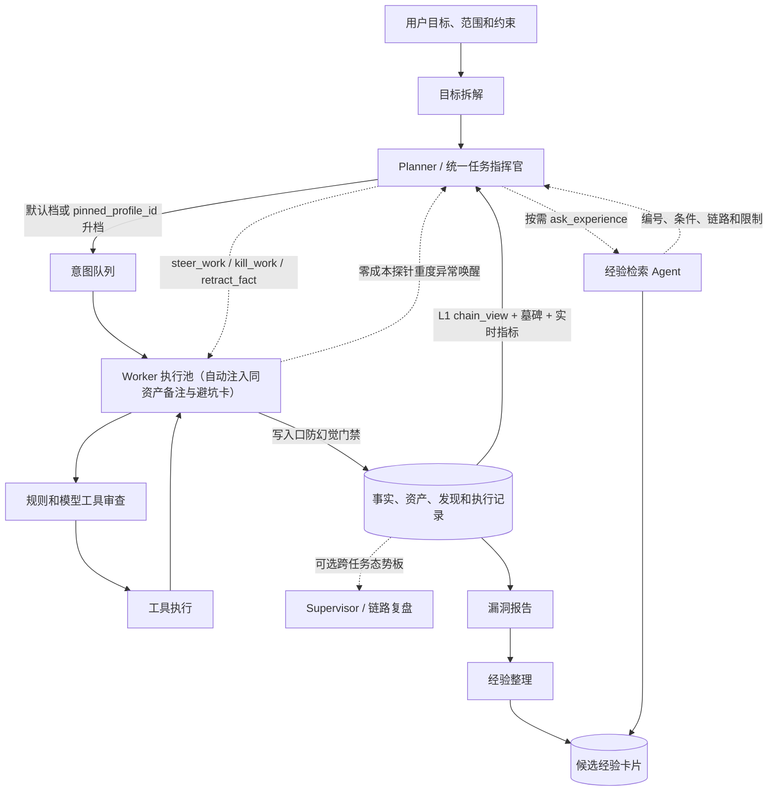

# BTERX

基于 [ARTEX](https://github.com/RuoJi6/ARTEX) 的授权安全测试 Agent 系统，保留 Go 后端、Next.js 前端和 PostgreSQL 探索图，并加入统一任务指挥官（规划 + 督战 + 主动模型分级）、写入口防幻觉门禁与级联撤回、同资产实时共享/确定性避坑卡、异步链路复盘、报告链路经验整理及按需经验检索。

当前版本为 `0.3.27-opt.6-task-commander`：在 v0.3.27 基础上加入统一任务指挥官（Planner 集成主动模型分级 `pinned_profile_id`、L1 分层链路视图与墓碑、防早停校验、零成本运行期探针主动唤醒、`retract_fact` 级联止损与同资产备注自动推送），同时保留经验交付/采用追踪、可取消意图写入和后台分批删除。11月13日原始导入清单作为历史基线保留；当前代码继续维护。不包含生产数据库、任务报告、流量、模型密钥或已编译程序。上游代码及 AGPL-3.0 许可证保留；Go module路径保留原值。

- [当前架构与 Agent 职责](docs/architecture.md)
- [统一任务指挥官、模型分级与防黑板污染](docs/supervisor.md)
- [已部署优化、收益及限制](docs/optimizations.md)
- [模型在哪些位置受到约束](docs/model-constraints.md)
- [构建、扩展安装与验证](docs/setup.md)
- [来源、快照和验证记录](docs/source-snapshot.md)
- [与上游 v0.3.30 的实际区别](docs/upstream-comparison-20261117.md)
- [v5交付、验证与发布](docs/memory-v5.md)
- [删除阻塞与迟到写入修复](docs/runtime-stall-fix-20261118.md)
- [后台分批删除与共享资料保护](docs/resumable-delete-20261120.md)
- [上游原始说明](README.upstream.md)

## 协作方式



单任务内由升级后的 Planner 作为唯一任务指挥官统筹规划、止损、主动模型分级（常规探测走默认快模型，复杂利用链/卡点按 `pinned_profile_id` 升档强模型或换厂商）、假事实级联撤回（`retract_fact`）及同资产备注沉淀（`record_asset_note`）；事件驱动为主（Worker 结束、新发现、运行探针重度异常即时唤醒），10 分钟心跳兜底。Worker 写入无证据的高影响或 `observed` 事实时自动降级为 `unverified`，启动时自动由代码推送同资产备注与确定性核验避坑卡。跨任务 `supervisor_*` 与 `chain_review_*` 工具仍保留给 `chain_reviewer` 按需启用。经验查询默认直接用 PostgreSQL 词法检索返回卡片，不强制每轮前置 RAG。

## 当前实现的边界

程序会校验工具权限、记录归属、引用、版本、状态以及写入口的基本证据门槛（缺证据的高影响/`observed` 事实自动降级 `unverified`，支持指挥官核查后 `retract_fact` 级联止损），但仍没有对每个结论做全自动独立复现验真；`confirmed` 事实不等于已经过独立复测。完整 TMS、ALL/ANY 前置依赖、合成节点和独立 Linker Agent 仍是后续设计，不能当作已有能力。

## 快速构建

需要 Go（版本以 `go.mod` 为准）、Node.js 22 和 PostgreSQL；Python 经验扩展另需 Python 3.10+ 与 `psql`。

```bash
cd web
npm ci
npm run build:static
cd ..
mkdir -p server/webui/dist
cp -a web/out/. server/webui/dist/
CGO_ENABLED=0 go build -trimpath -tags embedui \
  -ldflags='-s -w -X main.version=0.3.27-opt.6-task-commander' \
  -o artex ./cmd/artex
cp config.example.json config.json
# 在本地 config.json 配置数据库；模型和权限在自己的部署中配置。
./start.sh
```

经验和链路复盘辅助程序在 `extensions/`，需要另外部署、配置工具和 Agent，见[安装说明](docs/setup.md)。`presets/` 保存无凭据的提示词、预算和工具绑定参考；它不是已经应用到新数据库的运行配置。

## 许可证

沿用上游 [GNU Affero General Public License v3](LICENSE)。前端和其依赖的许可证随原文件保留。
