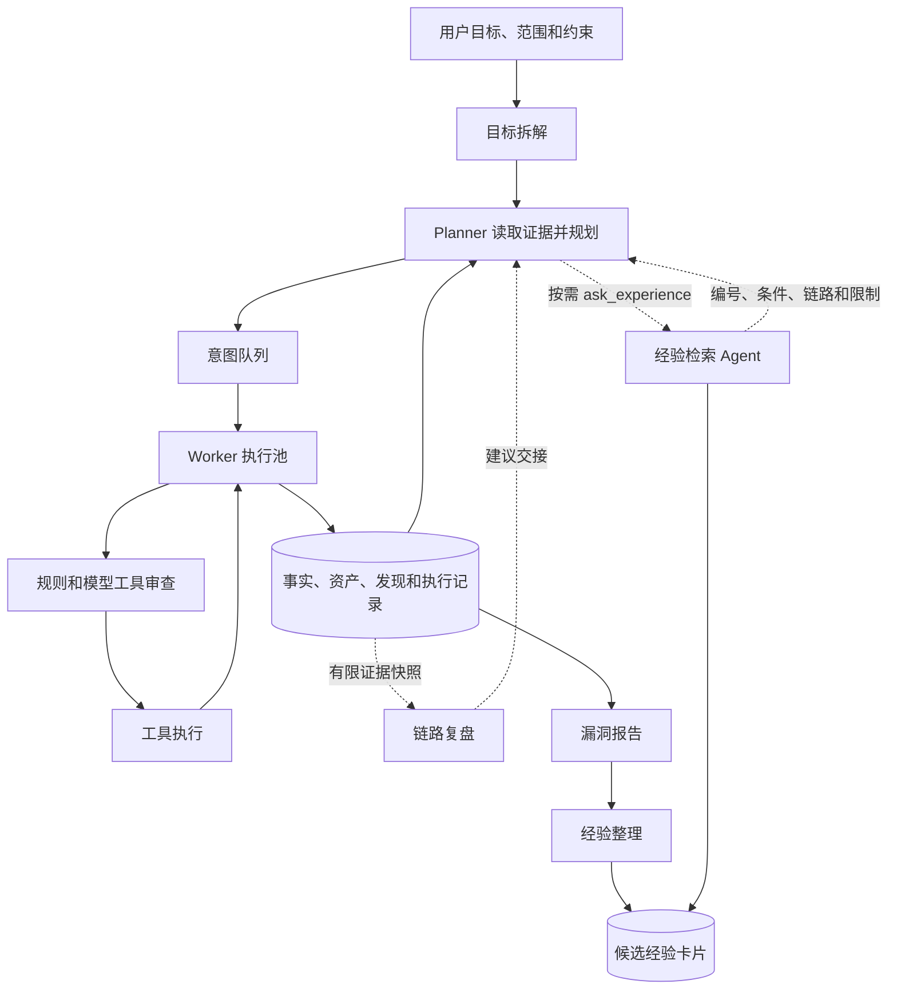

# BTERX

基于 [ARTEX](https://github.com/RuoJi6/ARTEX) 的授权安全测试 Agent 系统，保留 Go 后端、Next.js 前端和 PostgreSQL 探索图，并加入规划约束、异步链路复盘、报告链路经验整理及按需经验检索。

当前导入的是 `0.3.27-opt.2-experience` 部署对应源码。它是可审阅的源码快照，不包含生产数据库、任务报告、流量、模型密钥或已编译程序。上游代码及 AGPL-3.0 许可证保留；Go module 路径也保留原值，避免改动内部导入。

- [当前架构与 Agent 职责](docs/architecture.md)
- [已部署优化、收益及限制](docs/optimizations.md)
- [模型在哪些位置受到约束](docs/model-constraints.md)
- [构建、扩展安装与验证](docs/setup.md)
- [来源、快照和验证记录](docs/source-snapshot.md)
- [上游原始说明](README.upstream.md)

## 协作方式



Planner 负责决策和派发，worker 负责执行。链路复盘检查当前任务的证据与推导，经验整理为后续任务积累可迁移方法，经验检索只在被询问时运行。检索采用 PostgreSQL 标签、关键词和中文片段匹配，再由模型组织回答；没有独立向量数据库，也不强制每轮前置 RAG。

## 当前实现的边界

程序会校验工具权限、记录归属、引用、版本和状态，但没有独立证明模型的每个结论。当前 fact 的 `confirmed` 和 worker 自报的 `observed` 都不等于已通过独立验真。TMS、Observation/Claim 强制拆分、ALL/ANY 前置依赖、合成节点和 Linker Agent 仍是后续设计，不能当作已有能力。

## 快速构建

需要 Go（版本以 `go.mod` 为准）、Node.js 22 和 PostgreSQL；Python 经验扩展另需 Python 3.10+ 与 `psql`。

```bash
cd web
npm ci
npm run build:static
cd ..
mkdir -p server/webui/dist
cp -a web/out/. server/webui/dist/
CGO_ENABLED=0 go build -trimpath -tags embedui \
  -ldflags='-s -w -X main.version=0.3.27-opt.2-experience' \
  -o artex ./cmd/artex
cp config.example.json config.json
# 在本地 config.json 配置数据库；模型和权限在自己的部署中配置。
./start.sh
```

经验和链路复盘辅助程序在 `extensions/`，需要另外部署、配置工具和 Agent，见[安装说明](docs/setup.md)。`presets/` 保存无凭据的提示词、预算和工具绑定参考；它不是已经应用到新数据库的运行配置。

## 许可证

沿用上游 [GNU Affero General Public License v3](LICENSE)。前端和其依赖的许可证随原文件保留。
