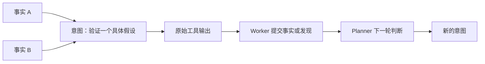
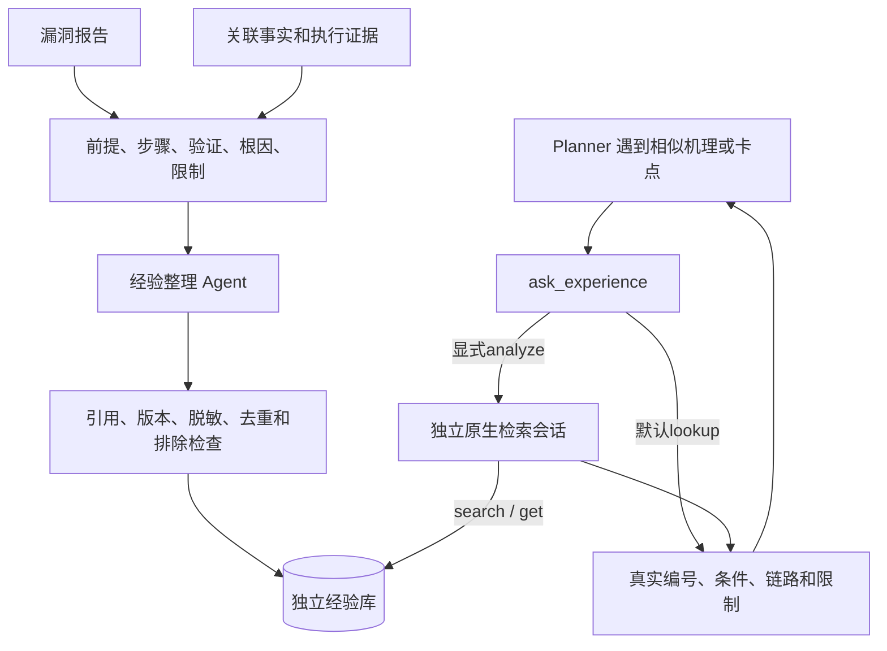

# 当前架构与数据流

本文件描述当前代码与已部署配置，不把讨论过的下一步方案当成实现。运行配置可在界面修改，`presets/` 是导出时的参考快照。

## 主循环

1. 用户提供目标、范围和操作约束，目标拆解 Agent 登记目标与约束。
2. Planner 每轮获得触发原因、任务态势、近期事实/发现、活动与历史摘要；需要细节时读取节点或执行记录。
3. Planner 用 `add_intent` 创建带 summary、资产、上游事实和优先级的意图。
4. Worker 领取意图，在任务目录内运行工具，执行前经过工具审查，结果写入活动记录。
5. Worker 写回资产、fact、finding 和最终文本；意图结束或发现变化唤醒 planner，心跳只是兜底。
6. Planner 核对后补方向、等待前提、纠偏 worker，或使用 `prove_goal` 标记目标完成。

多个父节点已支持，但 `parent_ids` 是来源血缘，没有必要依赖的 ALL/ANY 语义，不能保证上游结论真实或仍有效。

## 13 个 Agent

| 角色 | 触发 | 职责 |
| --- | --- | --- |
| goals | 创建任务 | 拆解目标与约束 |
| planner | 结果变化、提示、心跳 | 证据核对、派发、目标判定 |
| worker | 领取意图 | 工具执行，提交事实、资产和发现 |
| mainagent | 任务内对话 | 解释进度、干预、提示和派活 |
| chain_reviewer | 默认 15 分钟 | 有限快照复盘，给出遗漏、剪枝与待补证建议 |
| experience_curator | 默认 30 分钟；目标/超时事件 | 从报告和证据提炼候选经验 |
| experience_retriever | `ask_experience` 按需 | 返回历史方法的编号、前提、链路和限制 |
| reporter | 发现上报事件或人工请求 | 撰写、重写或归并漏洞报告 |
| retester | 人工启动 | 独立复测与保存结论 |
| credential_processor | 凭据事件和恢复队列 | 规则优先整理凭据，必要时模型提取 |
| asset_mapper | 人工启动 | 解释已有资产关系与拓扑 |
| auto | 对话角色 | 操作平台、任务、工具和配置 |
| pentest | 对话角色 | 独立规划执行模式，不是额外 worker 槽 |

Judge 和 compactor 是后台服务。Judge 判断动作是否允许，不判漏洞真伪；compactor 压缩冷历史，不生成跨任务经验。

## 经验卡片与文本 RAG

卡片保存标签、适用条件、根因、步骤、成功判据、踩坑、不适用条件、来源版本、状态和范围。`attack_chain` 每步记录前提、动作、实际结果及证据引用。

通用经验可以跨项目返回脱敏方法，原始证据只在来源任务或同公司任务内读取。自动条目统一 `candidate`；管理员独立审核后才能设 `verified`。来源变化、撤回或排除使条目失效，使用反馈不能提升审核状态。

成功、否定、无法判定三种outcome均支持。v5在finding/报告与稳定终态任务之外，分批读取有直接事实证据且稳定15分钟的终态意图，保留否定结果的机会；纯工具、网络、模型错误不应抽象成技术死路。整理run和采用结果关联见[memory-v5.md](memory-v5.md)。

## 异步与等待

报告、复盘、凭据整理、经验整理在主循环旁路运行，共享服务器、数据库和上游模型容量。`ask_experience`默认lookup不启动模型；显式analyze才有限等待检索会话，最多120秒。检索不是每轮规划的前置义务。

## 当前认识论缺口

- Worker 仍自己解释输出并填写证据与 confidence，fact 写入没有逐项独立验真。
- Planner 先看有限摘要，需要按需展开依据，存在摘要误导风险。
- `prove_goal` 校验记录类型和归属，不是程序化任务判题器。
- 复盘发布 advisory hint，不自动撤回 fact、重置目标或暂停依赖分支。
- 历史经验不替代当前证据，也不更新模型权重。
