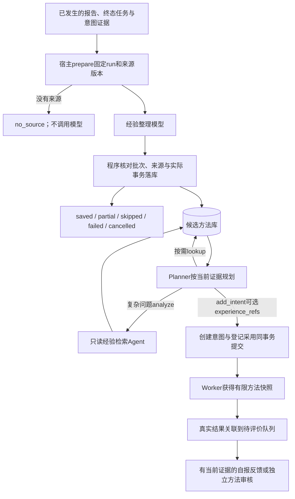

# 经验交付与采用追踪 v5

2026-11-17部署版本：`0.3.27-opt.3-memory-v5`。经验扩展协议：`20261116-delivery-adoption-v5`。

这次先补可核验交付、采用归属和结果追踪。模型权重不变，不承诺解题成功率提高；Planner仍默认16轮、240秒，六次宽泛读史限制保留。自适应预算、TMS、ALL/ANY和Linker未纳入此次发布。

## 实际流程

`experience_curator`只允许publish；`experience_retriever`只允许search/get/stats。装配过滤与执行前hook双重检查，禁默认命令、文件、联网和后台工具。材料是待核对数据；角色白名单不是操作系统沙箱。

`experience_refs`只表示采用历史方法，不是当前事实或授权。最多3条，校验作用域、当前状态、版本、来源排除、证据与依赖新鲜度。程序原子登记adopted并冻结有限摘要；执行前撤回的经验不交给Worker。终态意图无真实结果则inconclusive，不因done自动helpful。有真实结果进入pending_review，可由按任务调用experience_stats查看；方法审核仍是独立管理员流程。

来源只读现有记录；意图需终态、结果稳定15分钟且有直接事实证据。每批最多3个来源；意图候选先取有界近期窗口再计算版本，避免全库相关子查询超时。合法跳过也保存提炼器版本，避免每小时重新处理同一份没有可迁移方法的材料。纯模型/网络故障通常跳过，不能当作技术否定；语义判定仍需要模型或独立审核。

查询仍采用PostgreSQL词法检索；新增有限中英文术语映射与根因/链路权重。get按单条检查，search按召回条目检查当前可用性；不引入向量服务或每轮必查。

## 验证

| 检查 | 结果与边界 |
| --- | --- |
| Python基础检查 | 73项：68通过、5项数据库测试在该命令中skip |
| 专用PostgreSQL集成 | 19项通过，包括发布、幂等、外部批次拒绝、缺交付、no_source、skip、取消、负向来源与纠正后失效 |
| Go定向回归 | agent/db/server的Experience、Planner、ChainReviewer和相关脚本测试通过，使用独立本机容器数据库 |
| 宿主执行链 | 真实Python子进程＋真实数据库＋确定性假模型：空来源不调模型、口头完成失败、真实保存、合法跳过、取消五类通过 |
| 真实数据量影子prepare | 仅写随机隔离经验schema，约11秒准备intent＋finding；无读取警告；随后取消并清理 |
| 冻结检索样本 | 15张合成卡、30条查询：不启用别名20/30，启用后30/30；应无命中误推荐0；额外模型调用0 |
| 发行构建 | 带内嵌现有静态前端的Go构建通过；未改前端源代码，未重跑npm |
| 线上lookup | 返回2卡，约0.84秒；没有模型调用 |
| 线上真实模型整理 | 宿主准备来源成功；模型输出阶段180秒超时，run正确记cancelled、保存0条、最终活动is_error=true。不能写成真实模型发布成功 |
| 线上采用存储路径 | 预先排除采集、暂停的纯本地合成验收任务；调用同一原生DB方法，创建意图、取得方法快照、关联合成结果，得到result_available/pending_review。0模型调用、0目标请求；不是自主采用或解题收益评测 |

小样本检索结果只证明已知术语和固定访问边界可用，不能声称真实命中率100%或解题率提升。全量Go检查未全绿，资产范围/审批等用例失败；这些代码未被此次改动，旧基线单独复查又超过60秒限制。失败的根因尚未全部查清；只报告相关定向测试通过，不表述为全仓库测试通过。

## 发布记录

二进制SHA-256：`8625353ffa06fdc1a5542398914a23bca56a2a90b423ad9f5f93024ebb14d1f8`。

第一次切换的50秒健康检查窗口不足，程序与原版均在启动DDL阶段等待较久；已恢复旧程序和任务后，将窗口改为180秒重新发布。14:07新版本健康，原有3个活动任务及触发器恢复；不改用户模型绑定、原始提示词正文和触发周期，只更新受本扩展管理且通过CAS的协作部分/工具合同。

私有回滚备份在服务器：`/home/maming/backups/artex-memory-v5-20261117T060605Z`。源码与构建记录位于`/home/maming/.local/share/artex-experience-upgrade/20261116/build-source`。私有配置和备份不进Git；数据库迁移只加表/列，回滚保留审计和经验数据。

核对时还存在模型上游503/无可用账号，且真实模型整理超时。下一步效果评估需在模型服务可用后，观察新任务中的结构化采用、当前结果和独立评价；不能用候选数量或检索次数代替收益。
