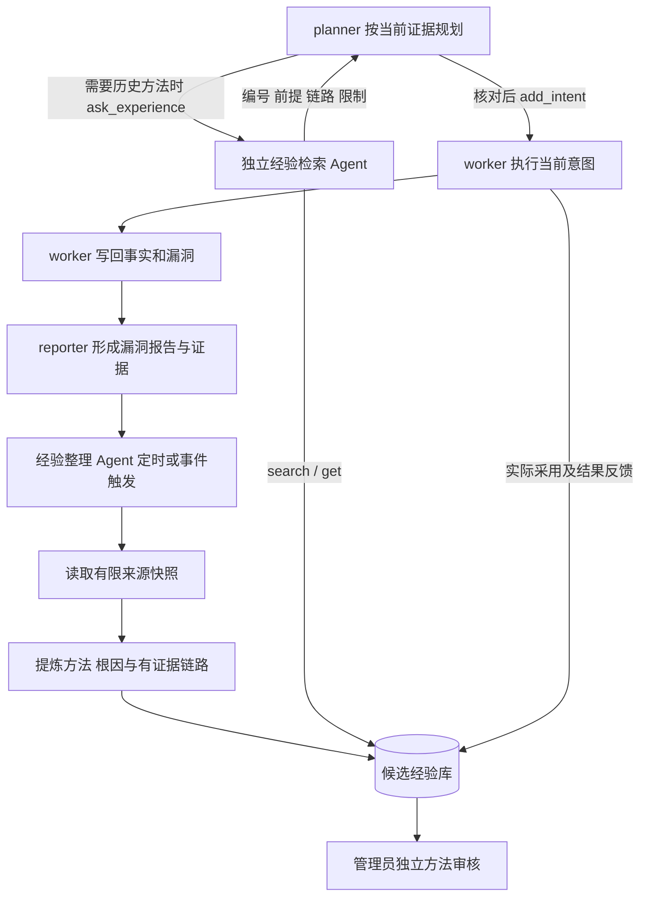

# ARTEX 经验整理与复用扩展

本扩展通过 ARTEX 已有的自定义工具、Agent、提示词版本和周期触发器接入经验库。经验单独保存在 PostgreSQL 的 `artex_experience` schema，原始任务、finding、流量和执行记录保持原有结构。采用文本 RAG：结构化标签、关键词检索和有证据的链路摘要，不依赖独立向量数据库。

## 工作方式

经验整理 Agent 每 30 分钟，以及目标达成、任务超时时被唤起。事件上下文有明确任务编号时，快照使用 `source_task_id` 限定该任务；周期整理不猜测任务编号。每次只读取少量来源快照，优先从漏洞报告、关联事实和执行证据提炼具体链路，保存有来源引用的候选经验；没有合适来源就结束。

独立的“经验检索”Agent 没有定时触发器。planner 在遇到相似机理、路线阻塞或需要组合链路时，可按需调用 `ask_experience`；扩展通过 ARTEX 原生对话 API 为检索 Agent 创建可审计会话，等待有限时间后把经验编号、前提、链路和限制返回调用方。检索 Agent 最多检索三条、详读两条，只绑定 search/get/stats，不绑定发布、反馈或 ask，避免递归。已有证据充分时 planner 可以直接派发，检索不是每轮、首次规划或每个意图的强制前置条件。

新建的整理与检索 Agent 均使用 `llm_profile_id=NULL`，跟随用户当前激活模型，不固定绑定历史配置。升级不改已有整理 Agent 的模型设置。检索 Agent 默认4轮、100秒；桥接最多等待120秒并在超时后停止该检索会话。问答失败或无匹配不阻止 planner 正常工作。

七个工具分别为：

| 工具 | 用途 | 使用者 |
| --- | --- | --- |
| `ask_experience` | 按需询问独立经验检索 Agent，返回条件、链路和编号 | planner及其他解题 Agent |
| `experience_snapshot` | 获取少量待整理的来源证据快照 | 经验整理 |
| `experience_publish` | 校验来源并保存经验 | 经验整理 |
| `experience_search` | 按任务范围、标签和关键词检索 | 解题 Agent、经验检索 |
| `experience_get` | 读取完整方法、限制和证据摘要 | 解题 Agent、经验检索 |
| `experience_feedback` | 记录采用、有效、无效或不适用 | 解题 Agent |
| `experience_stats` | 查看经验和使用统计 | 解题 Agent、经验检索 |

经验可包含可选 `root_cause` 和 `attack_chain`。每步按顺序保存前提、操作、实际结果和本来源真实证据编号；旧经验没有这些字段仍可检索。没有实际衔接证据时保持单步或明确缺口，不把一条成功命令泛化成任意权限，也不把监听地址当作公网可达。



`task_id=0` 的查询只能读取通用经验；项目专属经验需要来源任务或同公司任务上下文。没有公司归属的项目经验只在来源任务可用，不能据此声称已有跨任务复用。通用经验只保存脱敏的方法，不能保存历史 Cookie、Authorization、口令或其他可直接复用的会话材料。

## 候选与已验证经验

所有自动提炼的经验一律进入 `candidate`，表示有来源的待审核方法。普通任务结束、目标被标记达成、finding confirmed 或复测 completed/reproduced，都不能直接证明模型提炼的抽象方法正确，更不能自动证明拿到 flag。

`verified` 必须由管理员在独立审核流程中核对方法、前提、证据和限制后显式设置。来源 confirmed/reproduced 只作为 `verification_basis` 的一部分保留，不能替代方法审核；整理 Agent 和使用反馈不能自行提升状态。已审核方法也不代表 CTF 平台自动判题通过，不代表换一个目标仍然有效。来源撤回或证据变化时，已有审核状态会被撤销，需要重新整理和审核。

管理员审核脚本 `review_entry.py` 不注册为 Agent 工具。先通过读取工具核对经验正文和来源，再由管理员运行以下命令；将 `EXPERIENCE_ID` 和说明替换为真实值，不要未经核对直接确认：

```bash
python3 /home/maming/apps/artex-experience/review_entry.py EXPERIENCE_ID verified --note '填写实际核对过的方法、前提、证据和限制，至少20个字符' --method-and-evidence-reviewed
```

同一脚本可用 `candidate` 撤回方法审核，或用 `deprecated` 停止复用，均需填写审核说明。它不执行目标验证，审核记录单独保留。

失败结论同样可以有价值，但限流、网络不可达、模型失败、预算耗尽或执行超时只能说明未完成测试，不能总结成技术方向不可行。经验必须写清重新尝试的条件。

## 安装与检查

将本目录中实现文件放到服务器 `/home/maming/apps/artex-experience`，仅允许服务账户访问。默认从 `/home/maming/apps/artex-1/config.json` 在进程内读取数据库连接，不显示配置和凭据。

先检查清单：

```bash
python3 /home/maming/apps/artex-experience/installer.py dry-run --offline
python3 /home/maming/apps/artex-experience/installer.py dry-run
```

执行安装并核对状态：

```bash
python3 /home/maming/apps/artex-experience/installer.py install
python3 /home/maming/apps/artex-experience/installer.py status
```

如需自定义配置或 schema，将全局选项放在子命令前面：

```bash
python3 /home/maming/apps/artex-experience/installer.py --config /path/to/config.json --schema artex_experience status
```

安装器先保存私有备份和安装状态（权限 `0600`），再执行加表迁移及配置事务。它会拒绝覆盖不能确认属于本扩展的同名工具或 Agent。新增工具绑定到当前实际存在的解题角色；报告撰写、复测和链路复盘 Agent 的提示词保持原样。已有 Agent 模型不变，新建经验 Agent 跟随全局激活模型。

扩展表和提示词在新运行中读取；已经运行中的长会话可能继续使用原有工具集合，直到下一次运行。需要注意，11月9日的 planner 代码另有硬工具白名单，仅修改数据库绑定无法让新工具在 planner 中执行。本次 ask/search/get/feedback/stats 必须加入真实运行版本的 planner 白名单、构建和部署后，再验收原生工具调用；不能把“工具表已绑定”当作 planner 可用证据。重复执行 `install` 不生成重复提示词或触发器，也不覆盖安装后用户在界面做出的修改。

## 已安装环境的增量升级

已有安装执行 `install` 会按幂等规则保留现状，不会自动更新新提示词或工具定义。更换本目录实现文件后，用单独升级命令先检查差异，再应用：

```bash
python3 /home/maming/apps/artex-experience/installer.py upgrade --dry-run
python3 /home/maming/apps/artex-experience/installer.py upgrade
python3 /home/maming/apps/artex-experience/installer.py status
```

升级只更新有本次安装所有权标记、且未被用户后续修改的工具及触发消息，并安全插入本扩展新增的检索 Agent 与 ask 工具。planner 等已有协作提示词，当前指针等于登记版本时可以替换协作块；如用户只修改了其他正文，而协作块仍逐字等于旧登记版本，也只替换该块，保留用户正文和模型设置。协作块自身被改、标记异常或缺基线时列入 `skipped`。整段正文与指针均受事务内 CAS 守护。回滚基线记录用户当前版本，避免恢复最初整段提示词而丢掉用户后续修改。

升级前私有备份保留当前提示词指针、工具定义和触发配置，升级后登记新版本编号与基线哈希。`status` 可见修订号和是否存在待核对的中断升级。若应用事务或后续状态保存中断，安装器停止盲目重试；应核对 `backups/upgrade-before-*.json` 与实际指针。完整回滚仍只恢复当前指向本扩展版本的提示词，保留用户后续编辑。

后台会逐批整理符合条件的旧记录，不会把旧 finding 的确认状态直接当成方法审核。一次候选快照最多三个来源，默认两个；整理 Agent 有固定轮数和时间上限。

## 查看和使用

在 ARTEX 的 Agent 管理中查看“经验整理”和“经验检索”。前者有自动会话，后者只在收到 `ask_experience` 时产生会话。需要借鉴历史链路时可询问“当前这种机理有哪些相关经验，前提和不适用条件是什么”，由对应 Agent 使用工具处理。需要检查存量时可调用 `experience_stats`；不要把生成报告或说“已经记住”当作数据库保存成功，应该核对工具返回的经验编号。

验收时应区分三个层次：数据库中有工具和提示词、整理 Agent 实际保存候选、解题 Agent 实际检索并反馈。`experience_search/get/feedback` 的 ARTEX 工具调用记录才能证明解题侧使用；管理员直接运行 smoke test 产生的 usage 记录不等于解题 Agent 已主动复用，更不能据此声称解题效果提高。

反馈区分 `adopted`（实际采用）与 `helpful`（已有当前执行结果支持）。某条经验被检索到或看起来相关，不应自动算有效。持续使用后的收益需要通过未参与经验整理的题进行对照，观察成功率、耗时、工具调用和误报，而不能按经验条数推断。

## 回滚

```bash
python3 /home/maming/apps/artex-experience/installer.py rollback
python3 /home/maming/apps/artex-experience/installer.py status
```

回滚只停用本次安装拥有的工具、经验整理/检索 Agent 和整理触发器。只有解题 Agent 当前提示词仍指向安装器创建的版本时才恢复安全基线指针；如用户后来又编辑过提示词，保留该修改。已保存的经验、反馈及来源快照不删除。若本次还部署了 planner 白名单二进制修改，程序版本回滚使用对应部署备份，和扩展配置回滚分开处理。

`install-state.json` 和 `backups/install-before-*.json` 保留安装前提示词及本次新增编号，均为私有文件。不要将这些文件公开或作为对话附件发给模型。若安装过程被中断，先用 `status` 核对；安装器只会恢复可确认已提交的安装，不会盲目覆盖已有状态。已回滚的安装不会被重复 `install` 自动重新启用。

## 限制

- 本扩展改变外部经验的积累和使用方式，不更新模型权重，也不保证题目越刷成功率一定越高。
- 经验检索是有条件的参考。历史任务的目标、授权、凭据和某个接口的结论不能自动继承到新任务。
- ARTEX 通用自定义会话仍可能带有默认文件、命令和网络工具。仅绑定经验工具和写提示词不构成严格沙箱；经验整理提示词要求不调用这些工具，runtime 自身限制来源读取和经验写入，但不能据此宣称整个 Agent 已被技术隔离。
- 周期触发和队列由 ARTEX 管理；重启、模型不可用、超时或 Agent 未完成发布都可能延迟整理。应核对工具结果，不能声称一次触发必然生成经验。
- 当前不包含专用经验管理页面或向量检索服务；先使用现有工具与会话观察效果，再按检索评测决定是否增加。
